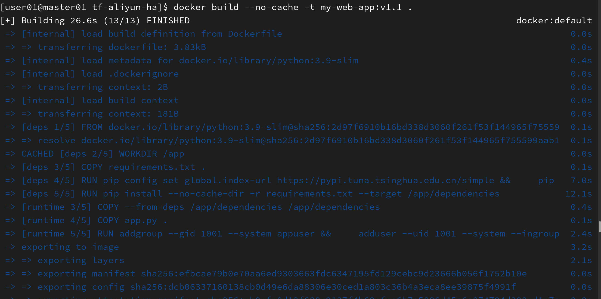
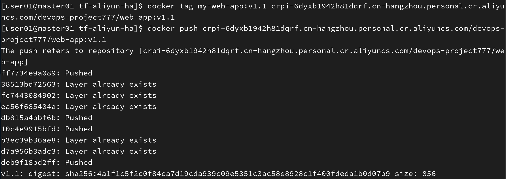
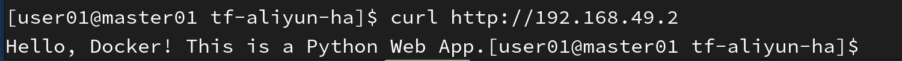
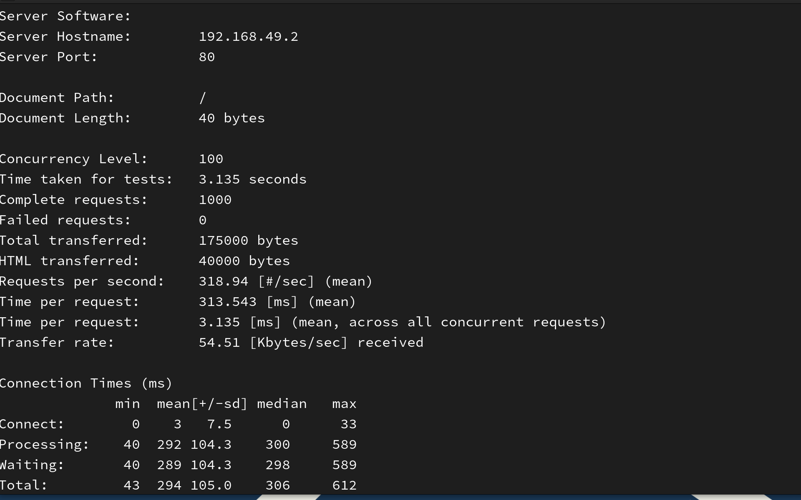

# 🐳 云原生 Web 应用容器化 + K8s 部署

> 第二周项目：Docker 容器化 + Kubernetes 部署实践

## 📌 项目简介

本项目是一个 Python Flask Web 应用的容器化与 K8s 部署实践。通过 Docker 多阶段构建优化镜像体积，并在 Minikube 集群中实现 3 副本高可用部署。

## 🎯 核心成果

| 指标 | 优化前 | 优化后 | 提升 |
|------|--------|--------|------|
| 镜像体积 | 500MB | **200MB** | **↓ 60%** |
| QPS (吞吐量) | 254 req/s | **319 req/s** | **↑ 25%** |
| 平均响应时间 | 393ms | **314ms** | **↓ 20%** |

## 🛠️ 技术栈

| 技术 | 用途 |
|------|------|
| Python 3.11 + Flask | Web 应用 |
| Docker (多阶段构建) | 容器化，镜像体积优化 60% |
| Minikube | 本地 K8s 集群 |
| Kubernetes (Deployment/Service/Ingress) | 容器编排，3 副本高可用 |
| Gunicorn | 生产级 WSGI 服务器（替代 Flask 开发服务器） |
| 阿里云 ACR | 私有镜像仓库 |

## 📂 项目结构

```
cloud-native-web-app/
├── app/
│   ├── app.py              # Flask 应用
│   ├── Dockerfile          # 多阶段构建
│   └── requirements.txt
├── k8s/
│   ├── deployment.yaml     # 3 副本 Deployment
│   ├── service.yaml        # ClusterIP Service
│   └── ingress.yaml        # Nginx Ingress
├── .gitignore
└── README.md
```

## 🚀 快速开始

### 1. 构建 Docker 镜像

```bash
cd app
docker build -t my-web-app:v1.1 .
```

### 2. 推送到 ACR

```bash
docker tag my-web-app:v1.1 crpi-6dyxb1942h81dqrf.cn-hangzhou.personal.cr.aliyuncs.com/devops-project777/web-app:v1.1
docker push crpi-6dyxb1942h81dqrf.cn-hangzhou.personal.cr.aliyuncs.com/devops-project777/web-app:v1.1
```

### 3. 部署到 K8s

```bash
kubectl apply -f k8s/deployment.yaml
kubectl apply -f k8s/service.yaml
kubectl apply -f k8s/ingress.yaml
```

### 4. 启用 Ingress 并访问

```bash
minikube addons enable ingress
curl http://$(minikube ip)
```

## 📊 性能测试

```bash
ab -n 1000 -c 100 http://192.168.49.2:80/
```
**测试结果：**
```
Requests per second:    318.94 [#/sec] (mean)
Time per request:       313.543 [ms] (mean)
Failed requests:        0
```

## 🤔 踩坑记录

### 1. 镜像拉取失败 (ImagePullBackOff)
- **原因**：ACR 私有仓库未配置 `imagePullSecrets`
- **解决**：创建 Secret 并在 Deployment 中引用

### 2. 健康检查导致 Pod 不断重启
- **原因**：livenessProbe 端口配置错误（3000 vs 5000）
- **解决**：修改端口为 5000，或删除健康检查

### 3. 代理导致镜像拉取超时
- **原因**：Minikube 配置了不可用的代理
- **解决**：移除代理配置，或确保代理地址正确

## 📝 后续规划

- [ ] 第三周：CI/CD 流水线（GitHub Actions）
- [ ] 第四周：监控告警体系（Prometheus + Grafana）


---

⭐ 如果这个项目对你有帮助，欢迎 Star！
