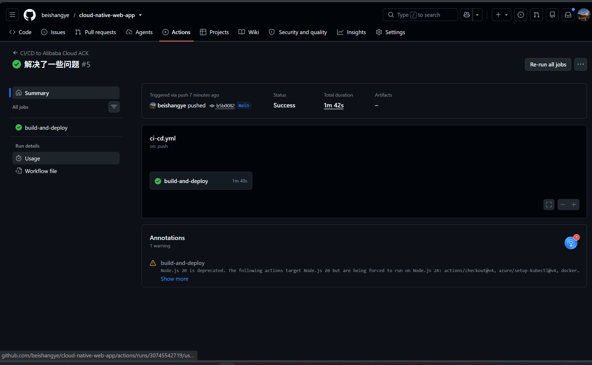
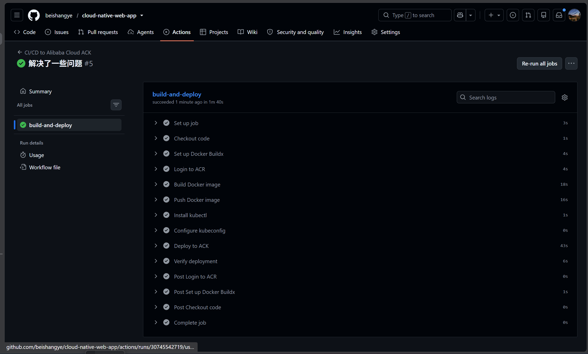
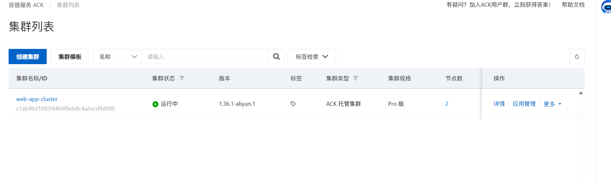
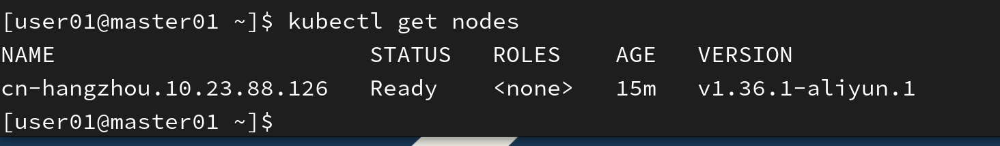
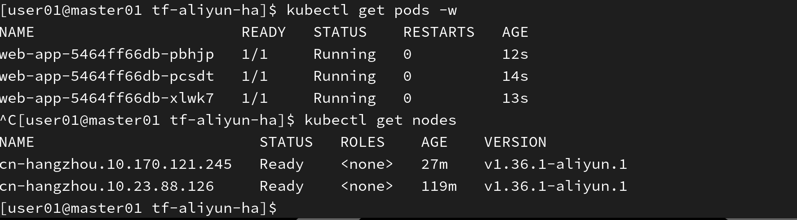
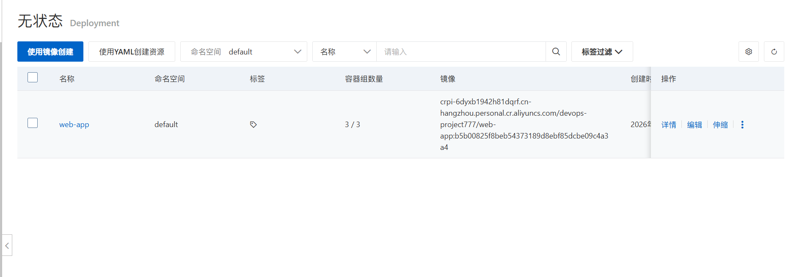
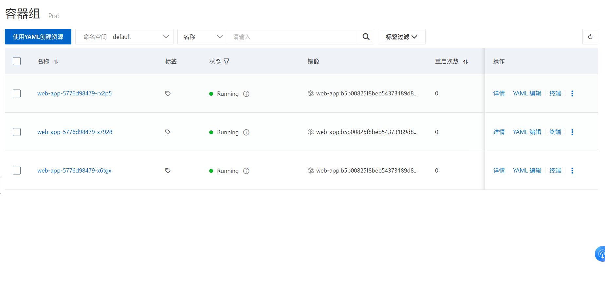
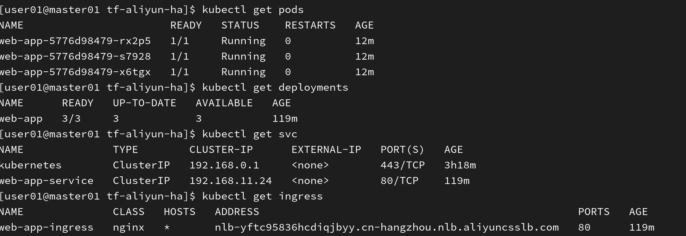
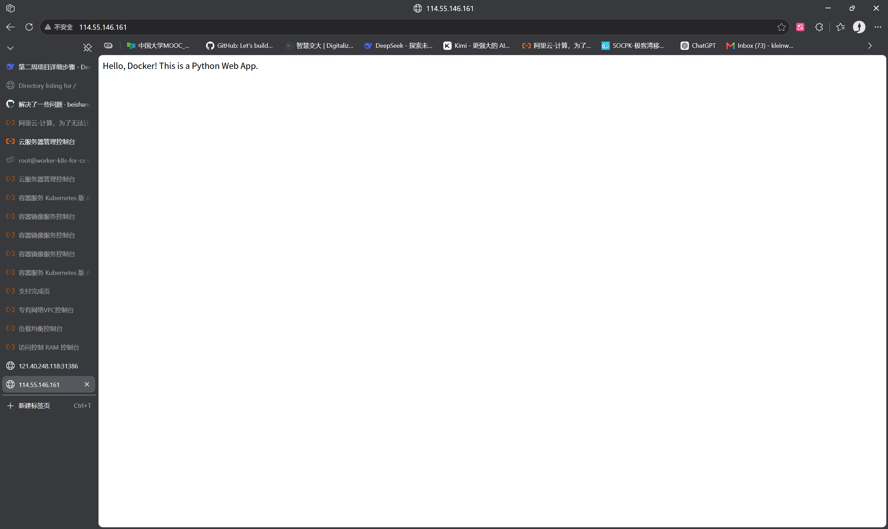
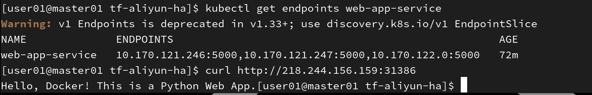

# 🐳 云原生 Web 应用容器化 + K8s 部署

> 第二周项目：Docker 容器化 + Kubernetes 部署实践
> 第三周增补：GitHub Actions + 阿里云 ACK 的 CI/CD 流水线
> 2026-10 修订：按生产标准做了一轮完整复盘与改造，详见文末「生产化改进记录」

## 📌 项目简介

本项目是一个 Python Flask Web 应用的容器化与 K8s 部署实践：Docker 打包 → 阿里云 ACR 私有仓库 → GitHub Actions 自动流水线 → ACK 托管集群多副本运行，并由 Service / Ingress 暴露服务。

## 🎯 核心成果

| 指标（ab -n 1000 -c 100） | 优化前 | 优化后 | 提升 |
|------|--------|--------|------|
| QPS（吞吐量） | 254 req/s | **319 req/s** | **↑ 25%** |
| 平均响应时间 | 393ms | **314ms** | **↓ 20%** |
| 失败请求 | 0 | **0** | — |


### 关于这个延迟数字的一个更正说明

早期版本 README 里写的是「通过多阶段构建把镜像体积从 500MB 优化到 200MB，下降 60%，因此 QPS 提升 25%」。**这个归因是错的，已在 2026-10 更正**：

1. **多阶段构建没有让这个镜像变小。** 本项目的两个阶段用的是同一个基础镜像 `python:3.11-slim`，runtime 阶段依然带着完整的 Python 解释器。多阶段真正的体积收益来自「builder 用带编译工具链的镜像，runtime 用 slim/alpine/distroless，只拷编译产物」——省掉的是 gcc/make 和头文件。而 Flask、gunicorn 都是纯 Python 包（wheel），根本不需要编译工具链。
2. **500MB → 200MB 这个数据无法复现、口径不明**，已从 README 移除。镜像体积请以本地实测为准：

   ```bash
   docker build -t web-app:local ./app && docker images web-app:local
   ```

3. **延迟下降的真实原因是并发模型与服务排队，不是镜像体积。** 用利特尔法则（Little's Law, `L = λ × W`）验算两组数据：
   - 优化前：254 req/s × 0.393s ≈ **100**
   - 优化后：319 req/s × 0.3135s ≈ **100**

   两者都恰好等于压测并发数 100，说明**队列被打满，平均响应时间几乎全部是排队时间**。按 4 个 sync worker 反推，单请求的真实服务时间只有 12ms 左右，剩下约 300ms 是排队。因此正确的优化方向是提升并发能力（worker 数量 / 协程模型），而不是继续抠镜像体积。这也是本次改造重新核算 gunicorn worker 数与 CPU 配额的依据。

## 🛠️ 技术栈

| 技术 | 用途 |
|------|------|
| Python 3.11 + Flask | Web 应用 |
| Docker | 容器化（多阶段构建，用于**分层缓存**而非缩减体积，见上文） |
| Minikube | 本地 K8s 集群验证（**注意：单节点环境不构成高可用**） |
| Kubernetes (Deployment/Service/Ingress) | 容器编排，3 副本多实例部署 |
| Gunicorn | 生产级 WSGI 服务器（替代 Flask 开发服务器） |
| 阿里云 ACR | 私有镜像仓库 |
| GitHub Actions | CI/CD 自动化流水线 |
| 阿里云 ACK | 托管 K8s 集群（v1.36.1-aliyun.1，生产部署） |

> ⚠️ 措辞更正：早期 README 称「在 Minikube 实现 3 副本**高可用**部署」。Minikube 是单节点集群，3 个副本都在同一台机器上，节点故障会导致全部实例同时不可用，**不构成高可用**。生产环境的高可用依赖 ACK 多 Worker 节点 + `topologySpreadConstraints` 打散调度，本次已补全。

## 📂 项目结构

```
cloud-native-web-app/
├── app/
│   ├── app.py              # Flask 应用（含 /healthz 健康检查端点）
│   ├── Dockerfile          # 多阶段构建
│   ├── requirements.txt
│   └── .dockerignore       # 构建上下文忽略清单（2026-10 新增）
├── k8s/
│   ├── deployment.yaml     # 3 副本 Deployment + 探针 + 打散调度
│   ├── service.yaml        # ClusterIP Service
│   └── ingress.yaml        # Nginx Ingress
├── .github/
│   └── workflows/
│       └── ci-cd.yml       # GitHub Actions CI/CD 流水线
├── .gitignore              # 2026-10 修复：此前误命名为 .gitigonre，规则从未生效
└── README.md
```

## 🚀 快速开始

### 1. 构建 Docker 镜像

```bash
cd app
docker build -t my-web-app:v1.1 .
```


### 2. 推送到 ACR

```bash
docker tag my-web-app:v1.1 crpi-6dyxb1942h81dqrf.cn-hangzhou.personal.cr.aliyuncs.com/devops-project777/web-app:v1.1
docker push crpi-6dyxb1942h81dqrf.cn-hangzhou.personal.cr.aliyuncs.com/devops-project777/web-app:v1.1
```


### 3. 部署到 K8s

```bash
kubectl apply -f k8s/deployment.yaml
kubectl apply -f k8s/service.yaml
kubectl apply -f k8s/ingress.yaml

# 发布后关注两件事：探针是否通过、副本是否被打散到不同节点
kubectl rollout status deployment/web-app
kubectl get pods -l app=web-app -o wide
```

### 4. 启用 Ingress 并访问

```bash
minikube addons enable ingress
curl http://$(minikube ip)
```


### 5. 健康检查端点

```bash
curl http://<pod-ip>:5000/healthz
# {"status":"ok"}
```

`/healthz` 是**独立于业务接口**的健康检查端点，不查询任何下游依赖。原因：如果直接把探针打在 `/` 上，一旦 `/` 依赖了数据库，一次下游抖动会让所有副本同时被判定不健康并被 kubelet 重启，把局部故障放大成整站不可用（级联故障）。

## 📊 性能测试

```bash
ab -n 1000 -c 100 http://192.168.49.2:80/
```
```
Requests per second:    318.94 [#/sec] (mean)
Time per request:       313.543 [ms] (mean)
Failed requests:        0
```

延迟构成分析见上文「关于这个延迟数字的一个更正说明」。

## 🔄 CI/CD 自动化部署（第三周）

代码推送至 `main` 分支后自动完成：镜像构建 → 推送 ACR → 部署 ACK 托管集群 → 业务可用性验证。

```
Git Push main → GitHub Actions → Docker Build → Push ACR
             → 渲染镜像 tag → kubectl apply（单次滚动更新）
             → rollout status 校验 → 失败自动 undo → ACK 集群运行 3 副本
```

工作流文件：[.github/workflows/ci-cd.yml](.github/workflows/ci-cd.yml)

### 流水线执行

push 代码到 `main` 分支后自动触发，全流程耗时约 1 分 40 秒。



流水线完整步骤全绿通过：代码拉取 → Docker 构建 → 推送 ACR → 安装 kubectl → 配置 kubeconfig → 版本校验 → 部署 ACK → 部署校验。



### 阿里云 ACK 集群准备

ACK 托管版 Pro 集群 `web-app-cluster`，K8s 版本 v1.36.1-aliyun.1，共 2 台 Worker 节点。



初始阶段 1 台 Worker 节点就绪：

```bash
[user01@master01 ~]$ kubectl get nodes
NAME                              STATUS  ROLES   AGE  VERSION
cn-hangzhou.10.23.88.126         Ready   <none>  15m  v1.36.1-aliyun.1
```


扩容后 2 台 Worker 节点就绪，3 个业务 Pod 均 Running：



### 部署结果验证（ACK 控制台）

**Deployment 无状态应用**：3/3 副本全部就绪。



**Pod 容器组**：3 个 web-app Pod 全部 Running、重启次数 0。



### 公网业务访问验证

NodePort 31386 暴露成功，两个公网入口均正常返回业务页面。





Service Endpoints 正确绑定 3 个后端 Pod IP + 5000 端口：



### 核心特性

| 特性 | 实现方式 |
|------|---------|
| 🔁 自动化触发 | main 分支 push 即触发全流程 |
| 📝 版本可追溯 | 镜像只打 `:${GITHUB_SHA}`，不再使用 `:latest` |
| 🚀 ACK 托管集群 | 2 Worker 节点运行 3 副本业务 |
| ⚖️ 负载均衡 | Service 轮询 3 个后端 Pod |
| 🌐 公网暴露 | NodePort + Ingress (NLB) 双入口 |
| 🩺 健康自检 | startup / liveness / readiness 三类探针 + `/healthz` |
| ↩️ 失败自愈 | rollout 失败自动 `rollout undo`，并留 `change-cause` 便于追溯 |

## 🧾 生产化改进记录（2026-10）

这一节记录了一次按生产标准做的完整复盘，共修 **9 处**。之所以把过程写进 README，是因为每一条都对应一个真实的运维决策点。

| # | 问题 | 修复 |
|---|------|------|
| 1 | **探针被删除**（最严重）。踩坑时 livenessProbe 端口误填 3000（容器实际监听 5000）导致反复重启，当时的处理是把探针删掉——典型的「关掉告警假装没故障」，后果是进程假死时 kubelet 完全无感，坏 Pod 一直挂在 Endpoints 里吃流量 | 补回 startup / liveness / readiness 三组探针，改用独立 `/healthz` 端点，加 `failureThreshold` 防止抖动误杀 |
| 2 | **`echo "${{ secrets.KUBECONFIG }}"` 存在命令注入风险**。`${{ }}` 是 YAML 解析阶段的字符串插值，secret 会被拼进**脚本文本**当成代码执行；日志脱敏在换行 / base64 后也会失效 | 改为 `env:` 传参 + `printf '%s' "$VAR"`，用后 `unset` |
| 3 | **一次 push 触发两次滚动更新**。apply 写死的 `:v1.0` 再 set image 到 sha，中间存在版本回退窗口，且 Git 声明与集群状态永久不一致 | CI 先把镜像渲染成本次 SHA 到 `.render/` 再整体 apply，单次滚动更新 |
| 4 | **发布失败无回滚**。集群可能停在「新老混合、副本不足」的降级状态 | `rollout status` 失败自动 `rollout undo` 并等待回滚完成，附 `kubernetes.io/change-cause` 注解 |
| 5 | **推送 `:latest`**，不可复现且不同节点可能跑不同版本 | 只推 `:${GITHUB_SHA}` |
| 6 | **kubectl 写死 v1.28.0 而集群是 v1.36.1**，相差 8 个 minor，远超官方支持的 ±1 | 跟随集群设为 v1.36.1，并新增版本 skew 自动校验步骤 |
| 7 | **第三方 action 使用浮动 tag**（`@v4`/`@v3`），存在供应链投毒风险；而 CI 恰好同时握有 ACR 凭据和 kubeconfig | 全部 pin 到完整 commit SHA，版本号写在行尾注释 |
| 8 | **`-w 4` 配 `limits.cpu: 500m`**，4 个 sync worker 抢 0.5 核必然触发 CFS throttle（CPU 监控看不出打满，延迟却飙升） | worker 降为 2、CPU limits 提到 1000m，按 `workers = 2×CPU+1` 对齐；此外补 `preStop` + `terminationGracePeriodSeconds` 保证优雅退出，补 `topologySpreadConstraints` 避免 3 副本挤在同一节点 |
| 9 | **`.gitignore` 被误命名为 `.gitigonre`**，规则从未生效；构建上下文也没有 `.dockerignore`，`.git` / `__pycache__` / 本地 `.venv` 会被打进镜像 | 修正文件名，新增 `app/.dockerignore`；同时 Python 3.9 已 EOL，统一升级到 3.11 |

### 顺带说明两处容易被误解的地方

- **Dockerfile 里的 `HEALTHCHECK` 在 K8s 中完全不生效。** 它只对 `docker run` / compose / swarm 生效，由 Docker daemon 执行；K8s 的健康检查由 **kubelet** 通过 Pod spec 里的探针完成。保留它是为了本地 `docker ps` 能直接看到 healthy 状态。
- **`deployment.yaml` 里没有 `imagePullSecrets`，是刻意的。** ACK 已开启 ACR 免密拉取（RRSA，走节点 RAM 角色），不需要在 YAML 里留凭证。早期踩坑记录里那条「创建 Secret 并在 Deployment 中引用」描述的是本地 Minikube 场景，现已注明。

## 🤔 踩坑记录

### 1. 镜像拉取失败 (ImagePullBackOff)
- **原因**：ACR 私有仓库未配置 `imagePullSecrets`
- **解决**：创建 Secret 并在 Deployment 中引用（**仅本地 Minikube 场景**；ACK 上改用免密拉取 / RRSA，见上文说明）

### 2. 健康检查导致 Pod 不断重启
- **原因**：livenessProbe 端口配置错误（写成 3000，容器实际监听 5000）
- **错误做法（早期采用）**：删除健康检查 —— 只会消除症状，让进程假死彻底失去发现手段
- **正确做法（2026-10 修正）**：把端口改成 5000，**保留并完善**探针；端点换成独立的 `/healthz`，避免业务接口依赖下游时被级联误判

### 3. 代理导致镜像拉取超时
- **原因**：Minikube 配置了不可用的代理
- **解决**：移除代理配置，或确保代理地址正确

### 4. gunicorn worker 数与 CPU 配额错配
- **原因**：`-w 4` 而 `limits.cpu` 只有 500m；容器里 `os.cpu_count()` 读到的是**节点**核数而非 CFS 配额，按它算 worker 数必然超配
- **解决**：按 `limits` 算（`workers = 2×CPU+1`），本项目调整为 `-w 2` + `cpu: 1000m`；若需更高并发应换 `-k gevent` 协程模型，而不是继续堆 worker

## 📝 后续规划

- [x] 第三周：CI/CD 流水线（GitHub Actions + ACK 自动化部署）
- [x] 2026-10：生产化复盘改造（探针 / 凭证安全 / 发布策略 / 资源配额，见上表）
- [ ] 镜像凭证改造：先用 ACR 机器人账号隔离，再过渡到 GitHub OIDC 换取临时 STS 凭证，彻底消灭长期密码
- [ ] 依赖漏洞扫描与版本锁定（当前 gunicorn 未锁版本，待接入 Trivy）
- [ ] GitOps 演进：引入 ArgoCD，由「CI 推」改为「集群拉」，从机制上保证集群状态 = Git 状态
- [ ] 监控告警体系（Prometheus + Grafana + Loki）
- [ ] HPA + PDB：基于指标的自动扩缩容，并保证滚动更新与节点排水时的可用性

---

⭐ 如果这个项目对你有帮助，欢迎 Star！
